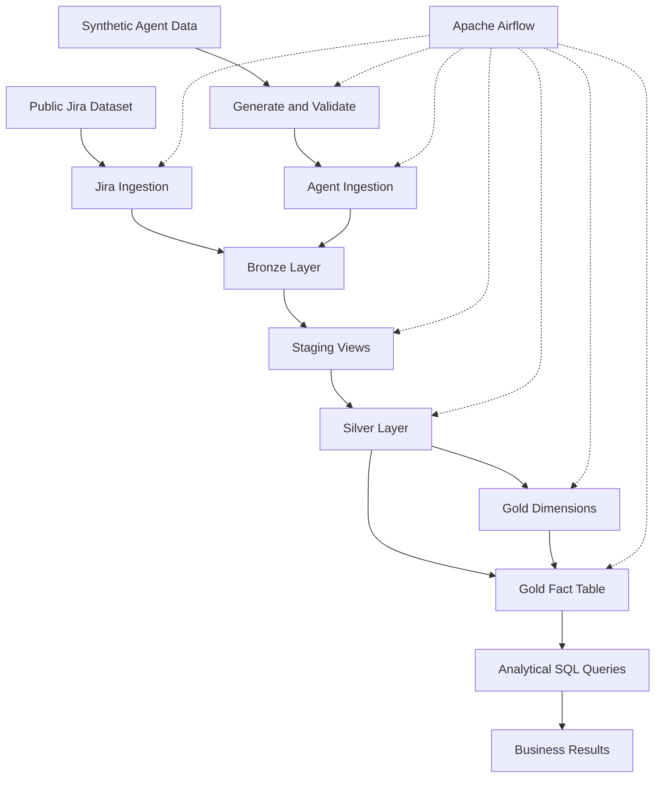

# Project Architecture

## 1. Introduction

The project implements a data engineering pipeline for analysing long term AI Agent memory management.

It combines public Jira issue data with synthetic AI Agent interactions. The architecture uses Apache Airflow for orchestration, PostgreSQL for storage and dbt for data transformation and testing.

The pipeline follows a Medallion Architecture with Bronze, Staging, Silver and Gold layers.

## 2. High Level Architecture

The architecture consists of five main components:

1. **Data Sources:** Public Jira data and synthetic Agent interactions.
2. **Ingestion:** Python scripts load source records into PostgreSQL.
3. **Orchestration:** Airflow manages task execution and dependencies.
4. **Transformation:** dbt creates staging, Silver and Gold models.
5. **Analytics:** SQL queries analyse the Gold star schema.

## 3. Architecture Flow

## 4. Data Sources

### Jira Dataset

The first source contains public Jira issue records. A sample of 10,000 issues is extracted and loaded into the Bronze layer.

### Synthetic Agent Interactions

The second source contains approximately 5,000 synthetic Agent interactions.

Each interaction includes information such as:

* Interaction ID and timestamp
* User and project identifiers
* Issue identifier
* Memory strategy
* Full history token count
* Selected context token count
* Input token count
* Retrieved memory count
* Retrieval latency
* Response latency

The synthetic dataset allows comparison of different memory strategies without requiring a production AI Agent.

## 5. Medallion Architecture

### Bronze Layer

The Bronze layer stores the original ingested records.

Main tables:

* `jira_issues_raw`
* `agent_interactions_raw`

Data is loaded using Python ingestion scripts. Jira ingestion uses PostgreSQL upsert logic based on issue identifiers.

### Staging Layer

The staging layer contains dbt views.

Models:

* `stg_jira_issues`
* `stg_agent_interactions`

These models extract required fields and prepare source data for further transformations.

### Silver Layer

The Silver layer contains cleaned and structured datasets.

Models:

* `silver_jira_issues`
* `silver_agent_interactions`

The Agent Silver model contains 5,000 experiment interactions. The Jira Silver model contains 10,000 issues.

### Gold Layer

The Gold layer provides an analytical star schema.

It contains one fact table and three dimension tables.

**Fact table**

`fact_agent_interaction`

Contains interaction measurements such as token consumption, retrieved memory counts, retrieval latency and context reduction.

**Dimension tables**

* `dim_date`: Date related information.
* `dim_project`: Project information.
* `dim_memory_strategy`: Memory strategy descriptions.

The fact table connects to all three dimensions using foreign keys. Primary keys are defined on the dimension tables.

## 6. Airflow Orchestration

Apache Airflow controls the complete pipeline using seven tasks.

| Task | Responsibility |
|---|---|
| `generate_test_data` | Generates synthetic Agent interaction data |
| `validate_test_data` | Checks generated data |
| `load_agent_bronze_data` | Loads Agent records into Bronze |
| `load_jira_bronze_data` | Loads Jira records into Bronze |
| `dbt_transformations` | Builds all dbt models |
| `create_gold_relationships` | Creates Gold primary and foreign keys |
| `dbt_data_quality_tests` | Executes dbt quality tests |

Both ingestion branches must finish before dbt transformations begin.

After the Gold models are built, the relationship task creates the database constraints. Finally, dbt executes its data quality tests.

The pipeline supports execution date and file version parameters.

## 7. dbt Transformation Design

dbt manages transformations through model dependencies using `ref()`.

The project contains eight models:

| Layer | Model count |
|---|---:|
| Staging | 2 |
| Silver | 2 |
| Gold | 4 |
| Total | 8 |

The Gold relationship creation is handled by a dbt macro called `create_gold_constraints`.

Airflow invokes this macro after dbt transformations. It checks whether the constraints already exist before creating them, making the operation safe to retry.

The project contains 11 dbt tests covering unique and not null requirements.

## 8. Database Design and Technology Selection

PostgreSQL 16 was selected as the database engine because it provides relational data storage, SQL querying, JSONB support, primary and foreign key constraints, and compatibility with Airflow and dbt.

The database separates data into four schemas:

* `bronze`
* `staging`
* `silver`
* `gold`

This separation makes the data processing stages easier to manage and understand.

## 9. Analytical Layer

The Gold star schema supports five analytical questions:

1. Context reduction by memory strategy.
2. Average input tokens by memory strategy.
3. Average retrieval latency by memory strategy.
4. Number of interactions by project.
5. Average retrieved memories by strategy.

These queries help compare memory strategies and understand the relationship between context size, token consumption and retrieval latency.

## 10. Validation Results

The fresh environment verification produced the following results:

| Component | Verified result |
|---|---:|
| Jira Bronze | 10,000 records |
| Agent Bronze | 5,040 records |
| Jira Silver | 10,000 records |
| Agent Silver | 5,000 records |
| Gold fact table | 5,000 records |
| dbt models | 8 successful |
| dbt tests | 11 passed |
| Gold constraints | 3 primary keys and 3 foreign keys |
| Airflow tasks | 7 successful |

The five analytical queries were also executed successfully.

## 11. Limitations

The Agent interaction dataset is synthetic. The token counts, retrieval latency and memory retrieval measurements are experimental values generated for this project.

The results demonstrate a data engineering and analytical workflow. They do not represent real world production performance.

## 12. Conclusion

The implemented architecture provides an automated pipeline for ingesting, validating, transforming and analysing Jira and synthetic Agent interaction data.

Airflow manages the workflow, PostgreSQL stores the data, and dbt manages transformations and data quality.

The Gold star schema provides a structured foundation for analysing different AI Agent memory management strategies.