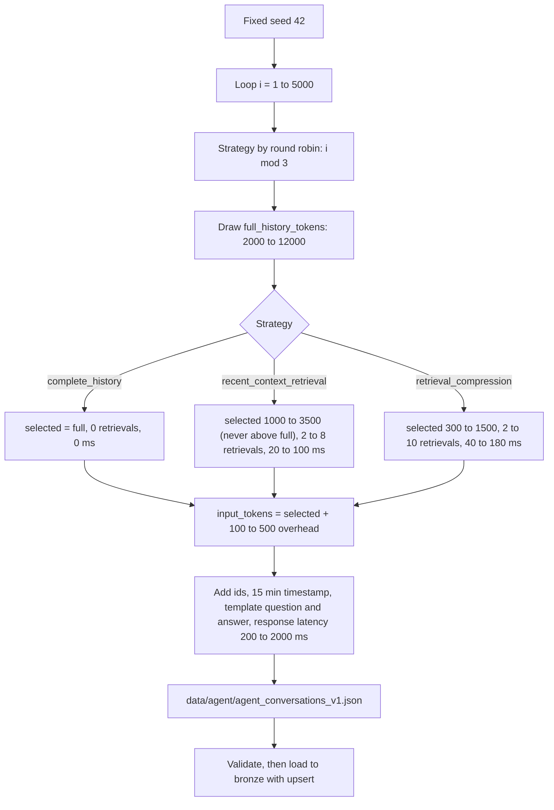
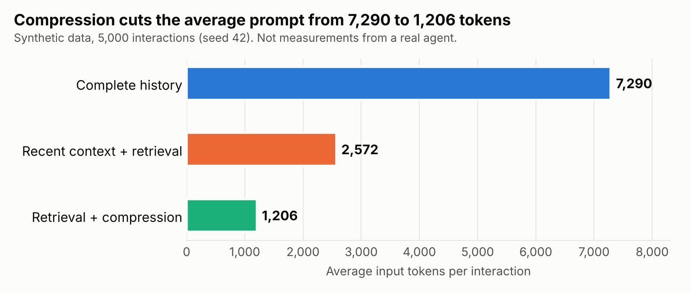
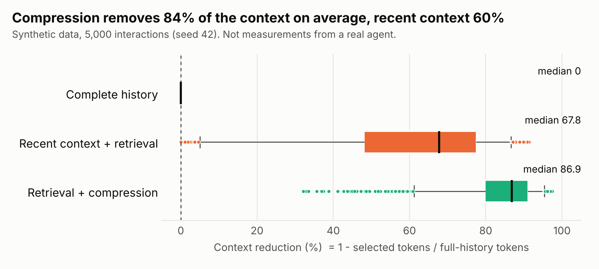
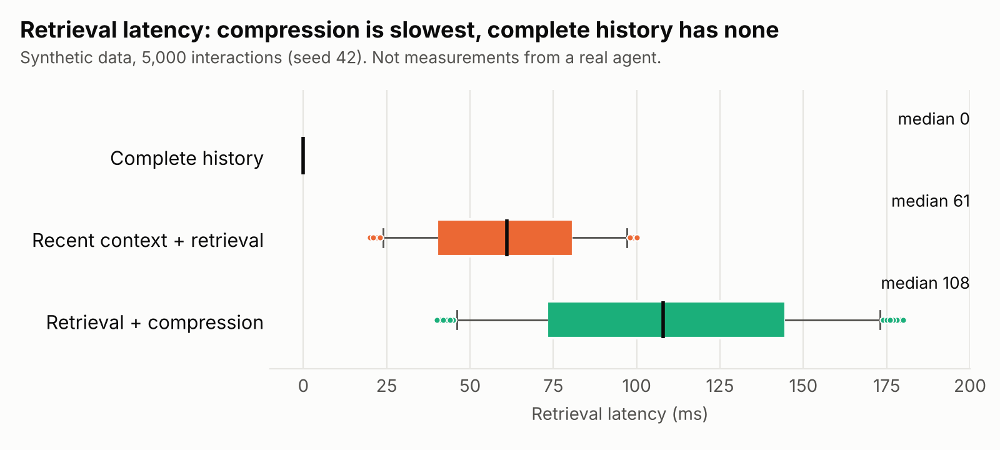

# Synthetic Agent Interaction Dataset

This document describes the second data source of the project: 5,000 synthetic AI Agent interactions. It explains why the data is synthetic, how it is generated, what every column means, what the data looks like, and what it can and cannot be used for.

> **Important:** every token count and latency in this dataset is generated from fixed random ranges. It is not measured from a running AI Agent. Results computed from it show that the pipeline works. They do not show how a real agent performs.

## 1. Why the data is synthetic

The project compares three memory strategies for a long-running AI Agent. No public dataset records which memory strategy an agent used for each question, together with token counts and retrieval times. The course allows one synthetic dataset when it is grounded in research and made as realistic as possible.

Grounding:
- The structure follows the long-term conversational memory benchmark of Maharana et al. (ACL 2024), where conversations are generated from underlying events and checked by people. We adapt the idea of event-based generation to project management questions. We do not claim to reproduce that benchmark.
- The questions are about issue histories, decisions and changes, the same content found in the public Jira dataset (Montgomery et al., MSR 2022), which is the first source of this project.

## 2. How the data is generated

Script: `scripts/generate_synthetic_data.py`. Output: `data/agent/agent_conversations_v1.json` (the version is part of the file name).



The seed is fixed, so running the script again produces the same file. All values below are drawn uniformly at random as integers inside the stated range.

| Field | Rule |
|---|---|
| `interaction_id` | `AGENT-00001` to `AGENT-05000` |
| `timestamp` | 2026-01-01 00:00 UTC plus 15 minutes per interaction |
| `memory_strategy` | Round robin: complete history, recent context, compression |
| `user_id` | 1 to 100 |
| `project_id` | One of 100, 200, 300 |
| `issue_id` | 100000 to 110000 |
| `user_question` | One of 5 fixed question templates |
| `agent_response` | One of 4 fixed response templates |
| `full_history_tokens` | 2,000 to 12,000, for every strategy |
| `selected_context_tokens` | Complete history: equals full history. Recent context: 1,000 to 3,500, capped at full history. Compression: 300 to 1,500 |
| `input_tokens` | `selected_context_tokens` plus 100 to 500 (question and fixed prompt overhead) |
| `retrieved_memory_count` | Complete history: 0. Recent context: 2 to 8. Compression: 2 to 10 |
| `retrieval_latency_ms` | Complete history: 0. Recent context: 20 to 100. Compression: 40 to 180 |
| `response_latency_ms` | 200 to 2,000, for every strategy |

## 3. Data dictionary

| Column | Type in the JSON file | Description |
|---|---|---|
| `interaction_id` | string | Unique identifier of one user-to-agent interaction |
| `timestamp` | string, ISO 8601 UTC | When the interaction happened |
| `user_id` | integer | Synthetic user, 1 to 100 |
| `project_id` | integer | Synthetic project, 100, 200 or 300 |
| `issue_id` | integer | Issue the question is about |
| `user_question` | string | Question asked to the agent (template) |
| `agent_response` | string | Answer returned by the agent (template) |
| `memory_strategy` | string | `complete_history`, `recent_context_retrieval` or `retrieval_compression` |
| `full_history_tokens` | integer | Tokens in the complete eligible history before the question |
| `selected_context_tokens` | integer | Tokens of history actually passed to the LLM |
| `input_tokens` | integer | Tokens in the full prompt, including question and fixed overhead |
| `retrieved_memory_count` | integer | Number of memory items retrieved |
| `retrieval_latency_ms` | integer | Time spent retrieving memory, in milliseconds |
| `response_latency_ms` | integer | Time until the response, in milliseconds |

Derived in the gold layer: `context_reduction_pct = (1 - selected_context_tokens / full_history_tokens) x 100`.

## 4. What the data looks like

### Size and balance

| Property | Value |
|---|---|
| Records | 5,000, all with unique `interaction_id` |
| Columns | 14 |
| Time range | 2026-01-01 00:15 to 2026-02-22 02:00 UTC (53 days) |
| Distinct users | 100 |
| Distinct issue IDs | 3,972 |

| Memory strategy | Interactions |
|---|---|
| Complete history | 1,667 |
| Recent context + retrieval | 1,667 |
| Retrieval + compression | 1,666 |

| Project | Interactions |
|---|---|
| 100 | 1,650 |
| 200 | 1,709 |
| 300 | 1,641 |

### Averages by strategy

These values match the results table in the README.

| Strategy | Context reduction | Avg input tokens | Avg retrieval latency | Avg retrieved memories | Avg response latency |
|---|---:|---:|---:|---:|---:|
| Complete history | 0.00% | 7,289.87 | 0.00 ms | 0.00 | 1,080 ms |
| Recent context + retrieval | 60.02% | 2,571.66 | 60.35 ms | 4.99 | 1,099 ms |
| Retrieval + compression | 83.80% | 1,206.49 | 108.54 ms | 6.03 | 1,095 ms |







How to read the box charts: the box covers the middle 50% of interactions, the black line is the median, the whiskers reach the 5th and 95th percentiles, and dots are interactions beyond the whiskers.

## 5. How to read the results

The ordering of the strategies is built into the generator. Compression is given the smallest context range and the slowest retrieval range, so it will always show the biggest reduction and the highest retrieval latency. Response latency is drawn from the same range for every strategy, so it shows no difference between them, as the table above confirms.

The results are therefore a check that the pipeline ingests, transforms and aggregates the data correctly. They are not evidence about real memory strategies.

## 6. Data quality

Checks in the repository:
- `scripts/ingest_agent.py validate` runs as an Airflow task before any load. It rejects the file when a field is missing, an `interaction_id` appears twice, a strategy is unknown, a count is negative, the selected context is larger than the full history, or the input tokens are smaller than the selected context
- Bronze loads use an upsert on `interaction_id`, so reloading the same file does not create duplicates, and every load writes a row to `audit.pipeline_runs`
- dbt tests check uniqueness, not null, accepted strategy values, the fact-to-dimension relationships and three business rules (`dbt/tests`)

Checks run on the delivered file: 0 duplicate IDs, 0 negative values, 0 missing fields, 0 rows where the selected context is larger than the full history.

### Issue found and fixed: selected context larger than full history

In the first version of the generator, the recent-context strategy drew the selected context (1,000 to 3,500 tokens) independently of the full history (2,000 to 12,000 tokens). When the full history was small, the selected context could be larger than it.

| Measure | Value before the fix |
|---|---|
| Affected interactions | 70 of 1,667 recent-context interactions (4.2%) |
| Other strategies affected | None |
| Lowest context reduction | -65.64% |
| Largest overshoot | 1,341 tokens |

This broke the Project 1 rule that selected-context tokens must not exceed full-history tokens. The fix caps the selected tokens at the full history (`min(random.randint(1000, 3500), full_history_tokens)`). It adds no extra random draw, so for seed 42 exactly 70 rows changed, and only their `selected_context_tokens` and `input_tokens`. The average context reduction of the recent-context strategy changed from 58.90% to 60.02%, and its average input tokens from 2,597.08 to 2,571.66. The validation step now rejects the old file, so the problem cannot come back unnoticed.

## 7. Limitations

- **Not measured.** Tokens and latencies come from random ranges, not from a tokenizer or a running system.
- **Strategies are not compared on the same cases.** Each interaction has its own independent random history size, so strategies are compared across different random samples, not on identical questions.
- **No answer quality.** Questions and responses are fixed templates, so answer quality cannot be measured and no quality column exists.
- **Not linked to Jira yet.** `project_id` and `issue_id` are random and do not point to real issues of the Jira dataset.
- **Regular timestamps.** Interactions are exactly 15 minutes apart, with no daily or weekly pattern.
- **Small variety.** There are only 5 question templates and 4 response templates.


## 8. How to regenerate and reload

The Airflow DAG `agent_memory_pipeline` does this automatically: it generates the file, validates it and loads it into bronze. To run the steps by hand, from the repository root with the Docker stack running:

```bash
docker compose exec airflow /opt/dbt-venv/bin/python /opt/airflow/scripts/generate_synthetic_data.py --output /opt/airflow/data/agent/agent_conversations_v1.json
docker compose exec airflow /opt/dbt-venv/bin/python /opt/airflow/scripts/ingest_agent.py validate --file-path /opt/airflow/data/agent/agent_conversations_v1.json
docker compose exec airflow /opt/dbt-venv/bin/python /opt/airflow/scripts/ingest_agent.py load --file-path /opt/airflow/data/agent/agent_conversations_v1.json --file-version v1
```

The first command rewrites the file (same content every time because of the fixed seed). The last loads it into `bronze.agent_interactions_raw` with an upsert, so it can be repeated safely.

## 9. References

1. Maharana, A. et al. (2024). *Evaluating Very Long-Term Conversational Memory of LLM Agents*. ACL 2024. https://aclanthology.org/2024.acl-long.747/
2. Montgomery, L., Lüders, C., and Maalej, W. (2022). *An Alternative Issue Tracking Dataset of Public Jira Repositories*. MSR 2022. https://zenodo.org/records/15719919
